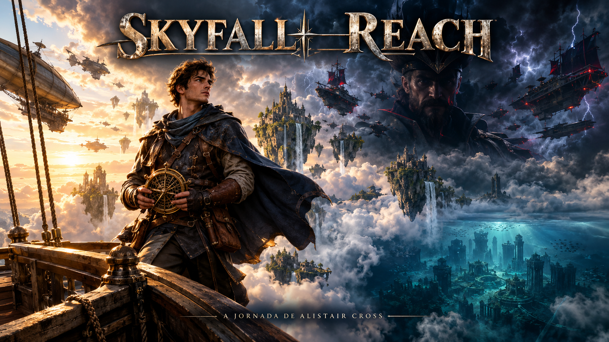
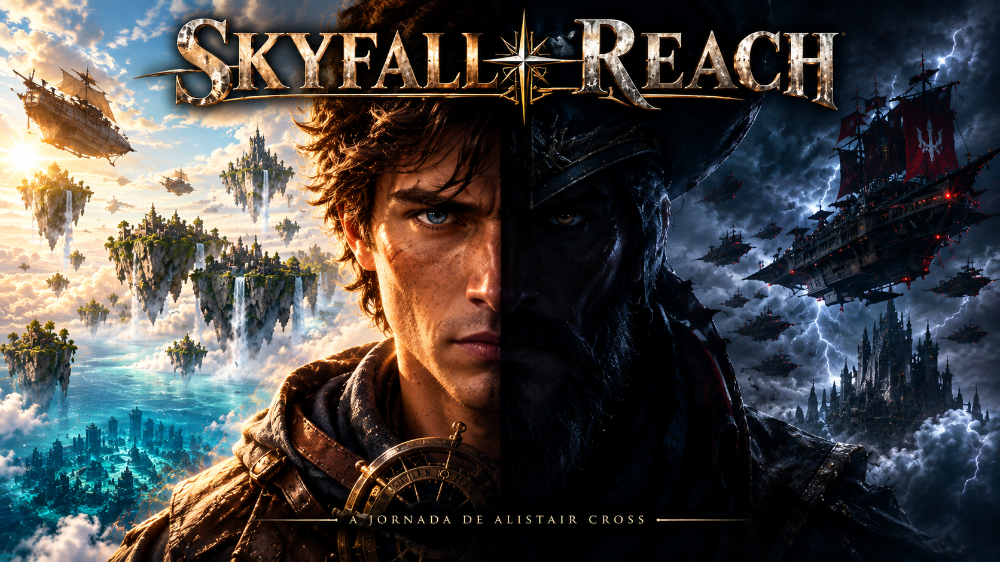
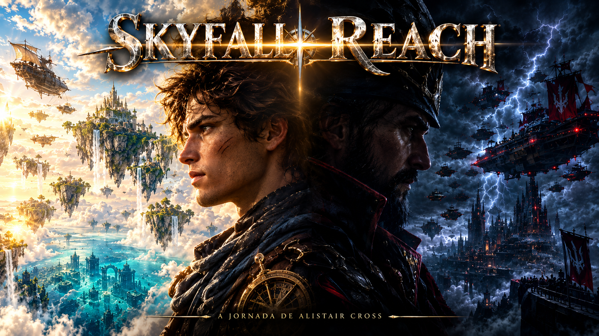

# ☁️ Skyfall Reach — A Jornada de Alistair Cross

## 📒 Descrição

Skyfall Reach é a ideia de um jogo fictício de ação e aventura, com exploração em mundo aberto. A história acompanha Alistair Cross, um jovem navegador e cartógrafo que explora ilhas flutuantes, oceanos misteriosos e ruínas antigas, enquanto enfrenta o temido Almirante Varek e sua frota de guerra.

A ideia foi criar uma capa que realmente parecesse a de um jogo, com personagens marcantes e um mundo cheio de mistérios. Também me inspirei em um dos animes de que gosto, trazendo um pouco dessa influência para a construção do universo e da atmosfera. Para tirar essa ideia do papel, usei inteligência artificial e fui ajustando os prompts até chegar ao resultado que mais gostei.

## 🤖 Tecnologias Utilizadas

- **ChatGPT:** para me ajudar a organizar as ideias e melhorar os prompts.
- **Inteligência artificial para geração de imagens:** para criar as diferentes versões da capa.
- **Markdown:** para organizar as informações e documentar o projeto.
- **GitHub:** para publicar o projeto e mostrar o resultado final.

## 🧐 Processo de Criação

Tudo começou com a ideia de imaginar como seria a capa de um jogo de aventura em um universo fantástico. Eu queria algo que chamasse a atenção, com um protagonista que transmitisse coragem e um vilão que passasse aquela sensação de ameaça.

Durante o processo, percebi que mudar alguns detalhes do prompt fazia bastante diferença no resultado. Por isso, criei três versões, experimentando diferentes composições até chegar à que mais combinava com o que eu tinha em mente.

### Versão 1 — Apresentando o universo

**Prompt utilizado:**

```text
Crie uma imagem digital panorâmica, no estilo de arte conceitual de capa de jogo, para o projeto Skyfall Reach.

O título SKYFALL REACH deve aparecer no topo, em uma fonte grande, metálica e imponente.

O protagonista é Alistair Cross, um jovem navegador e cartógrafo de aproximadamente 20 anos. Ele veste roupas de explorador, com couro e tecido, usa uma capa e está na proa de uma embarcação de madeira voadora, segurando um astrolábio metálico.

Ao fundo, entre nuvens tempestuosas, aparece a silhueta ameaçadora do Almirante Varek, líder da Ordem Maré Pura, acompanhado por couraçados aéreos de guerra.

O cenário deve ter ilhas rochosas gigantes flutuando entre nuvens, cachoeiras caindo no vazio e um oceano azul com ruínas de uma antiga civilização submersa.

A iluminação deve misturar o dourado do sol no lado do protagonista com as sombras, tempestades e raios no lado do vilão.

Use um estilo de realismo cinematográfico, com muitos detalhes e uma sensação de escala grandiosa.

Na parte inferior, inclua discretamente o texto: A Jornada de Alistair Cross.

Não inclua nomes de marcas de jogos.
```



**O que achei dessa versão:**

Essa foi a primeira tentativa de dar vida ao universo de Skyfall Reach. Gostei da ideia de misturar ilhas flutuantes, embarcações voadoras e ruínas antigas. Ela ajudou a estabelecer a aparência geral do projeto e a imaginar como seria esse mundo.

### Versão 2 — O confronto entre herói e vilão

**Prompt utilizado:**

```text
Crie uma imagem digital panorâmica para a capa do jogo fictício Skyfall Reach.

A composição deve ter uma divisão central marcante, destacando o rosto de Alistair Cross de um lado e a presença sombria do Almirante Varek do outro.

Alistair é um jovem navegador e cartógrafo de aproximadamente 20 anos, com expressão destemida e feições marcantes.

No lado esquerdo, mostre ilhas rochosas gigantes flutuando sob a luz dourada do sol, cachoeiras, nuvens claras e um oceano azul-turquesa com ruínas antigas submersas.

No lado direito, mostre tempestades escuras, relâmpagos e uma frota de navios de guerra aéreos da Ordem Darkness.

O título SKYFALL REACH deve aparecer no topo, em letras grandes, metálicas e imponentes.

Crie um contraste forte entre a luz do lado do herói e a escuridão do lado do vilão.

Use realismo cinematográfico, texturas detalhadas e uma composição digna de uma capa de jogo de aventura.

Na parte inferior, inclua o texto: A Jornada de Alistair Cross.
```



**O que mudei:**

Nessa etapa, quis dar mais destaque aos personagens. Em vez de mostrar principalmente o protagonista em seu mundo, a ideia passou a ser colocar o herói e o vilão frente a frente, deixando mais evidente o conflito entre os dois, além de alterar o nome da Ordem para algo mais tenebroso.

### Versão 3 — Perfis opostos (versão final)

**Prompt utilizado:**

```text
Crie uma imagem digital panorâmica, no estilo de arte conceitual para capa de jogo, para o projeto Skyfall Reach.

No centro da imagem, mostre os perfis de dois personagens em posições opostas.

À esquerda, Alistair Cross, um jovem navegador e cartógrafo de aproximadamente 20 anos, olhando para a frente com uma expressão destemida.

À direita, em oposição simétrica, mostre o perfil sombrio e misterioso do antagonista Almirante Varek.

No lado do herói, represente ilhas rochosas colossais flutuando sob a luz dourada do sol, nuvens claras, cachoeiras e um oceano azul-turquesa com ruínas antigas submersas.

No lado do vilão, mostre tempestades escuras, relâmpagos e uma frota imponente de navios de guerra aéreos da Ordem Darkness.

No topo, coloque o título SKYFALL REACH em uma fonte grande, metálica e imponente. Acrescente um brilho de luz passando sobre a tipografia, mantendo o título bem legível mesmo com a divisão central da imagem.

O estilo deve ser cinematográfico e realista, com texturas muito detalhadas, iluminação dramática e uma escala grandiosa.

Na parte inferior, inclua discretamente o texto: A Jornada de Alistair Cross.
```



**O que mudei:**

Essa foi a versão de que mais gostei. Os perfis opostos deram mais personalidade à capa e deixaram o contraste entre os personagens bem mais interessante. Também pedi um brilho sobre o título para que ele chamasse a atenção sem perder a leitura. No fim, senti que essa composição representava melhor a ideia que eu tinha imaginado para o jogo.

## 🚀 Resultados

A terceira versão foi a escolhida para representar o projeto. Gostei principalmente da forma como a imagem combina os dois personagens, os cenários opostos e o título, criando uma capa que poderia fazer parte de um jogo de aventura.


**Gênero:** Ação e Aventura Cinematográfica / Exploração em Mundo Aberto.

**Status:** Projeto conceitual fictício criado com auxílio de inteligência artificial.

## 💭 Reflexão

Uma das partes mais interessantes desse projeto foi perceber que não basta ter uma ideia: também é preciso saber explicar o que você quer para a inteligência artificial. Às vezes, uma pequena mudança na descrição já faz bastante diferença na imagem gerada.

Gostei de acompanhar a evolução das três versões e ver como a composição foi ficando mais próxima do que eu imaginava. Esse projeto também me mostrou que a IA pode ser uma ferramenta muito útil para explorar ideias criativas, desde que a gente participe do processo, faça escolhas e refine o resultado até ficar satisfeito.
